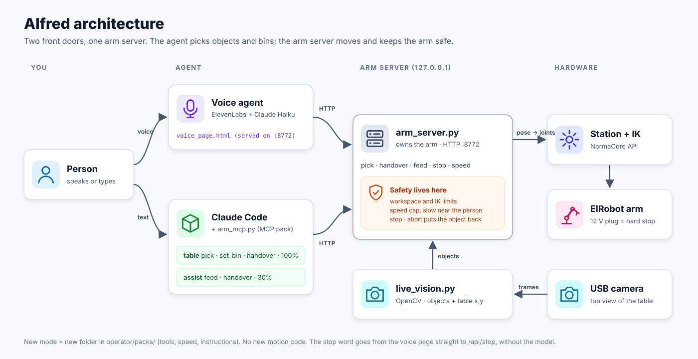
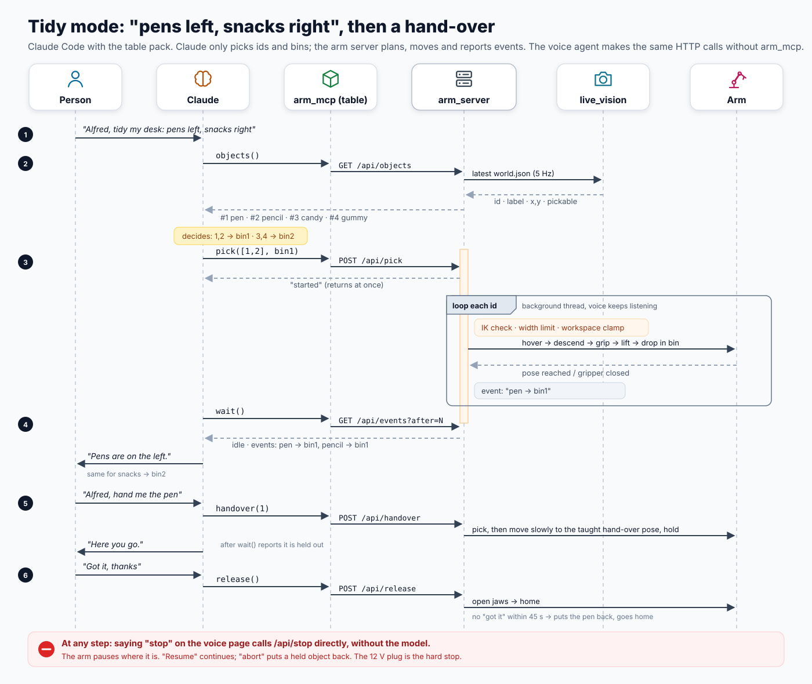

# Alfred: a voice-driven assistant arm

HackLab Robotics x BRISA, Berlin, 21-22 Nov 2026, NormaCore track. You talk to Alfred; a camera finds the objects, Claude decides what to do, and deterministic code moves the arm and keeps it safe.

**Modes are MCP packs.** One arm server owns motion, vision, speed limits and the stop. Each mode is a small pack (`operator/packs/<mode>/pack.json`) listing its tools, its speed and how Alfred behaves. A new mode is a new pack, not new motion code.

| Pack | What it does | Speed |
|---|---|---|
| `table` | Tidy the desk: sort objects into bins, hand one to you | full |
| `assist` | Feeding and hand-over for people with limited arm use | 30 % |



**Tidy mode, step by step:**



## Run Alfred on the arm
```bash
.venv/bin/python agent/live_vision.py              # camera -> objects (page on :8771)
.venv/bin/python agent/arm_server.py               # dry run: plans, nothing moves; add --go for the real arm
claude mcp add table -e PACK=table -- $PWD/.venv/bin/python $PWD/agent/arm_mcp.py
```
Then in Claude: *"Alfred, tidy my desk: pens left, snacks right."* The voice page on http://127.0.0.1:8772 (ElevenLabs) works beside it. Saying "stop", the STOP button and the 12 V plug always work. Details: [`operator/packs/README.md`](operator/packs/README.md).


**Visual overview:** open [`docs/field-guide.html`](docs/field-guide.html) in a browser.

## Setup (macOS)
You need [Homebrew](https://brew.sh). Then, in a terminal:

```bash
brew install uv gh
gh auth login                                  # your own GitHub account
gh repo clone thirumal1206/hacklab-2026-normacore
cd hacklab-2026-normacore
uv sync                                        # installs Python 3.12 and the pinned packages into .venv
make hooks                                     # pre-commit checks on every commit
make check                                     # must end with: ALL CHECKS PASSED
```

For the robot operator you also need **Claude Code** (`claude`) or **Codex**, each logged in with your own account.

## Earlier work: simulation and pack sorter
Where we started: a MuJoCo simulation, a CLI and MCP tools, and a pharmacy pack sorter. Kept for reference; Alfred does not need them.

### Run the simulation
Open three terminal tabs, all in the repo folder.

**Tab 1: the robot** (a simulated SO-101 arm, four cubes and a box):
```bash
.venv/bin/python arm.py serve --backend sim --seed 3
```
It prints `arm daemon on 127.0.0.1:8765` and keeps running. `--seed` changes where the objects start. `--scene objects` uses a pen, cup, eraser and tape roll instead of cubes; `--scene pencil` adds a thin pencil.

**Tab 2: the live view** (what the robot sees and does):
```bash
.venv/bin/python arm.py view
```
Open http://127.0.0.1:8766 in Chrome. It stays empty until the first command runs.

**Tab 3: drive it yourself** to see how it works:
```bash
.venv/bin/python arm.py locate          # parks the arm, lists objects; the marks image appears in the live view
.venv/bin/python arm.py pick red        # picks the object with id "red"
.venv/bin/python arm.py place green-box # drops it in a free corner of the box
.venv/bin/python arm.py score           # simulation only: which cubes are really in the box
.venv/bin/python arm.py reset 5         # new layout (seed 5)
```
`.venv/bin/python arm.py --help` lists every command.

### Let the model drive
**Claude Code** (recommended: Haiku is fast and cheap):
```bash
cd operator
claude --model haiku
```
Approve the `arm` MCP server when asked, then type: *Tidy the table: put every object into the box.* It reads `operator/AGENTS.md` and works through the MCP tools. Watch the live view. Check the result yourself with `arm.py score`: the model's own report can be wrong.

**Codex:** its sandbox blocks the daemon's network port. Start the daemon with a socket instead, and run Codex from `operator/` with the same variable:
```bash
ARM_SOCK=$PWD/runs/arm.sock .venv/bin/python arm.py serve --backend sim --seed 3
```
How Codex is given permission for the socket is not verified yet; see `venue/VENUE.md`.

### Talk to Alfred (voice assistant)
1. Start the daemon with a voice: `ARM_TTS=say` uses the built-in macOS voice. `ARM_TTS=voicestudio` uses the better voice if VoiceStudio runs locally on port 3900. `ARM_TTS=off` is silent.
2. In `operator/`, start `claude --model haiku` and type: *Run in assistant mode.*
3. In the live view, click **Hands-free** once and allow the microphone. Then speak: "Alfred, put the red cube in the box." Only sentences with "Alfred" reach her. "Alfred, stop" freezes the arm. You can also type into the box and press Enter.

Use headphones: otherwise the microphone can hear her voice. Chrome sends microphone audio to Google for speech recognition.

### Pack sorter demo (dashboard + voice + Claude, one command)
```bash
./demo.sh                                        # fake packs, macOS voice
```
It checks what it needs, opens the dashboard (http://127.0.0.1:8770) and starts Alfred (Claude Haiku, locked to the sorter tools). In Chrome press **Hands-free** and say "Alfred, sort the table", or type into the box. "Alfred, stop" or the STOP button freezes everything until RESUME.
On the arm laptop: `AGENT_BACKEND=real ARM_TTS=voicestudio ./demo.sh` (needs Station, the IK service and a filled `agent/config/`). Add `AGENT_DRY_RUN=1` the first time: it plans every move and moves nothing.

## Daily workflow
```bash
git switch main && git pull && uv sync         # start of the day
git switch -c feat/<topic>                     # one branch per change
make check                                     # before every PR
```
Add a short note with your measured result in `changelog.d/`, then open a PR for the other person to review. Rules are in `CONTRIBUTING.md`; agents follow `AGENTS.md`.

## Troubleshooting
| Symptom | Fix |
|---|---|
| `Address already in use` | A daemon is still running: `pkill -f "arm.py serve"` (or `"arm.py view"`), then start again. |
| Live view stays empty | Run any command (`arm.py locate`); the page only shows results of commands. |
| `uv sync` fails on `mujoco` | Run it inside the repo folder: uv must pick Python 3.12 from `.python-version`. |
| `Connection refused` from `arm.py` | Tab 1 is not running, or it uses another port (`ARM_PORT`). |
| The model says "done" but it isn't | Trust `arm.py score` (simulation) or `arm.py locate`, never its report. |

## Real robot
Follow `venue/VENUE.md`: Station version and address, `arm.py bringup` (joint directions, gripper, calibration), smoke test, then the operator. The taught-grid fallback there needs no kinematic model.

## Documents
- `docs/field-guide.html`: the visual overview
- `docs/DESIGN.md`: architecture and decisions
- `docs/RESEARCH.md`: what fails elsewhere, and field learnings
- `venue/VENUE.md`: the plan for the event days
- `CHANGELOG.md` and `changelog.d/`: every experiment with its numbers
- `AGENTS.md` (repo-editing agents), `operator/AGENTS.md` (the robot-driving agent), `CONTRIBUTING.md` (how we work)

## Status
Real arm: voice picking, sorting and the feeding demo run on the arm (team runs, 22 Nov; no logged numbers here). Hand-over and the MCP packs are verified with a stubbed arm only; the hand-over pose must be taught first. Simulation: cubes 12/12, mixed objects 11/12.

The previous main (free-placement planner, motion report) is kept on branch `backup/main-2026-11-22`.

Private repository. Third-party parts keep their licences: `elrobot/` comes from norma-core (MIT), and `so101-sim/robotstudio_so101` carries its own licence.
